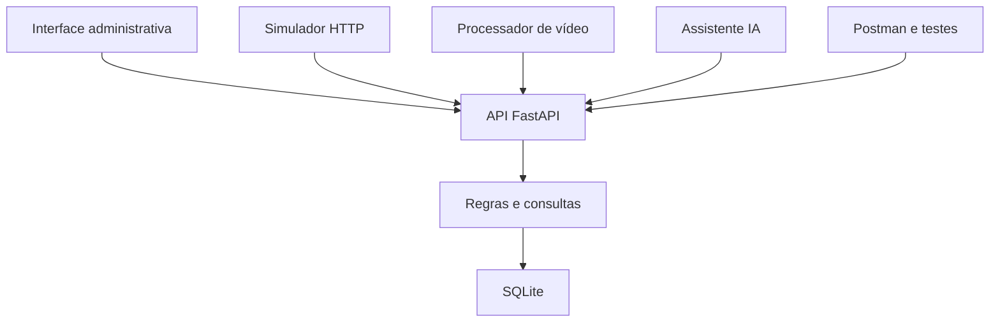

## Proposta e estrutura inicial de testes

> **Conflui: o movimento ganha sentido. Uma central administrativa que conecta ocupação, espaço e tempo na planta do Capim Dourado Shopping.**

O Conflui permite que a administração acompanhe quantas pessoas estão nas regiões monitoradas, onde se concentram e como a ocupação varia ao longo do dia. A planta real permanece no centro da interface: o calor é desenhado sobre ela com filtros por pavimento, setor, data e horário, sem perder a identidade original do shopping.

A experiência é exclusivamente administrativa. O visual original foi preservado, com identidade inspirada no capim-dourado, tons de marfim, verde profundo e dourado discreto. O frontend consulta uma API Python; eventos, favoritos, marcações e o protótipo de assistente administrativo são persistidos e processados no backend.

A navegação principal foi simplificada para manter a visão operacional focada em gestão e diagnóstico. As ferramentas de Comparações e Fluxos não aparecem mais no menu principal; em seu lugar, o gestor tem acesso ao Assistente IA, que interpreta dados reais disponíveis e responde com observações, interpretações e sugestões baseadas no contexto do shopping.

A área de perfil do público continua apresentando pesquisas agregadas independentes das câmeras, com fonte, período, denominadores e informações não declaradas. Gênero e idade são dimensões distintas. Não há reconhecimento facial, classificação dessas características por vídeo ou extrapolação para toda a ocupação do shopping.

**Estrutura inicial de testes**

| Verificação | Comportamento esperado |
| --- | --- |
| Autenticação | Exigir sessão válida; impedir consultas após expiração ou logout. |
| Aquisição | Validar câmera, setor, origem, captura e coordenadas; reenvio não duplica registros. |
| Histórico global | Todos os setores representam o mesmo instante consultado. |
| Meia-noite | 00h encerra a data operacional selecionada; não contamina a abertura seguinte. |
| Calendário | Meses corretos, inclusive fevereiro bissexto, e indicação de datas sem medições. |
| Persistência | Eventos, favoritos, marcações e análise do assistente permanecem no banco; favoritos pertencem ao administrador. |
| Perfil do público | Cada dimensão soma o denominador da amostra; ausência não é preenchida artificialmente. |
| Separação de origens | O ambiente de vídeo não consulta ou recebe observações do simulador. |
| Interface | Busca e seleção preservadas durante o polling; calor e assistente sem recarregar a página. |

A suíte e os limites da validação estão em [docs/VALIDACAO.md](docs/VALIDACAO.md). O banco fica no arquivo `conflui.db`, sem instalar um servidor de banco. `python configurar.py` prepara o ambiente local e `python iniciar.py` inicia a API e o simulador em processos separados no mesmo terminal. A execução local está documentada em [docs/EXECUCAO.md](docs/EXECUCAO.md).

## Documentação inicial do projeto

A aplicação reúne estas áreas:

| Área | Conteúdo |
| --- | --- |
| Login | Conta administrativa criada por comando local, sessão com expiração e saída. |
| Visão geral | Planta, calor a partir de posições disponíveis, ocupação e estado das medições. |
| Calendário e histórico | Data específica, horário global, replay e eventos/datas especiais. |
| Eventos | Cadastro, edição e exclusão; setores, público-alvo declarado e análises por período. |
| Assistente IA | Consulta os dados disponíveis e ajuda a interpretar ocupação, baixa utilização e ações de gestão. |
| Perfil do público | Pesquisa agregada por data, evento e setor, quando houver cobertura. |
| Relatórios | Consulta dos registros disponíveis e exportação CSV. |

A navegação foi desenhada para reduzir ruído operacional. Os módulos de Comparações e Fluxos foram removidos da interface principal, mantendo a visualização da planta e a análise do shopping como foco central.

O catálogo inicial contém dois pavimentos e 18 regiões conceituais delimitadas sobre os arquivos originais da planta. Essas regiões não comprovam cobertura física de câmeras. A integração com vídeo depende da definição da câmera responsável e de calibração para localizar detecções na planta. Sem posições calibradas, a interface mostra a contagem sem fabricar calor.

O modo `simulator` fornece dados sintéticos persistidos e identificados para demonstrar a aplicação. O modo `video` exige outra base e aquisição real. A API de câmeras da equipe ainda não foi disponibilizada; foi entregue um contrato inicial com simulador HTTP e uma prova de processamento de vídeo opcional.

Os contratos interativos ficam em `/docs` e `/openapi.json` quando a API está em execução. Os detalhes de medição, retenção, fontes e limites estão em [docs/CONTRATOS.md](docs/CONTRATOS.md). A coleção e o ambiente do Postman estão em [postman](postman).

## Linguagem de programação escolhida

| Parte | Linguagem | Aplicação |
| --- | --- | --- |
| Frontend | JavaScript | Interações, filtros, consultas à API, cache temporal e atualização do mapa. |
| Estrutura e apresentação | HTML e CSS com Tailwind CSS | Organização visual, identidade do produto e responsividade. |
| Backend | Python | FastAPI, permissões, validação, persistência, consultas e processador do Assistente IA. |

Tailwind CSS é a ferramenta obrigatória de estilização, utilizada junto ao CSS específico do mapa. O processamento opcional de vídeo também utiliza Python, em processo separado.

## Arquitetura

A arquitetura é cliente-servidor, com um único backend de aplicação. O frontend consulta a API; o simulador ou processador de vídeo envia observações autenticadas; o backend valida os registros, persiste os dados no SQLite e responde às análises do assistente administrativo por regras determinísticas sobre o contexto disponível.

| Componente | Responsabilidade |
| --- | --- |
| `frontend` | Interface original, Canvas/SVG, polling, filtros temporais e chat do assistente. |
| `backend/conflui/main.py` | Endpoints e coordenação das operações, incluindo `POST /assistant/analyze`. |
| `backend/conflui/services.py` | Consultas de ocupação, perfil e convenções temporais usadas na análise. |
| `backend/conflui/auth.py` | Hash de senha, verificação de sessão e autenticação da aquisição. |
| `backend/conflui/models.py` e `schemas.py` | Persistência e contratos validados, inclusive o payload do assistente. |
| `backend/migrations` | Evolução versionada do esquema. |
| `backend/conflui/simulator.py` e `video.py` | Aquisição em processos externos às requisições HTTP. |

O frontend utiliza consultas periódicas, com intervalo padrão de cinco segundos. A suavização do Canvas não cria novas medições. O histórico trabalha com timestamps com fuso; as consultas usam o horário de Palmas. Cada setor tem uma câmera autoritativa, evitando somar coberturas sobrepostas no MVP.

## Plataforma e tecnologia adotadas

| Tecnologia | Uso |
| --- | --- |
| Aplicação web responsiva | Acesso administrativo por navegador em computador e celular. |
| HTML e JavaScript | Estrutura, comportamento e integração com a API. |
| Tailwind CSS | Estilização obrigatória e classes utilitárias compiladas localmente. |
| Vite | Desenvolvimento e build do frontend. |
| Canvas 2D | Calor contínuo e suavização visual das posições disponíveis. |
| SVG | Regiões selecionáveis, marcadores e representação do mapa. |
| Python e FastAPI | API administrativa, aquisição e endpoint do assistente. |
| Pydantic | Validação de contratos e configurações. |
| SQLAlchemy e Alembic | Acesso ao banco e migrations. |
| SQLite | Banco em arquivo local, criado automaticamente na configuração do MVP. |
| Argon2id | Hash das senhas administrativas. |
| OpenCV, YOLO11n e ByteTrack | Prova opcional de vídeo, isolada do servidor HTTP. |
| Pytest e Node test runner | Verificações de API e contratos JavaScript. |
| Postman | Organização de requisições, exemplos e verificações da API. |
| Git | Versionamento e colaboração. |

O Postman é usado para testar e documentar a API; SQLite é o banco da aplicação. As dependências do vídeo são opcionais e separadas. A precisão em câmeras físicas e a execução do detector no equipamento do shopping ainda dependem de validação.

## Descrição de como a tecnologia ou prática sorteada será incorporada na solução

A tecnologia obrigatória escolhida é **Tailwind CSS**, dentro da opção CSS3/Tailwind.

O frontend mantém sua identidade visual e utiliza classes utilitárias nos layouts, filtros, painéis, formulários, botões e estados de interação. A configuração está em `frontend/src/tailwind.css`, com dependências e comandos no `frontend/package.json`.

O comando `npm run build` compila o Tailwind antes de gerar o build do Vite. O CSS complementar preserva os detalhes específicos da planta, do Canvas e da identidade inspirada no capim-dourado.

O assistente administrativo do Conflui foi implementado como um protótipo funcional orientado por regras. Ele consulta os dados disponíveis do shopping, interpreta setor, data, hora e evento, e devolve observações, interpretações e recomendações para ações do gestor, sem depender de um modelo de linguagem externo. Isso permite evoluir para um backend de IA real sem quebrar o fluxo atual da aplicação.

A documentação operacional completa, desde a instalação no Windows até a inicialização em dois terminais, está em [docs/EXECUCAO.md](docs/EXECUCAO.md).
