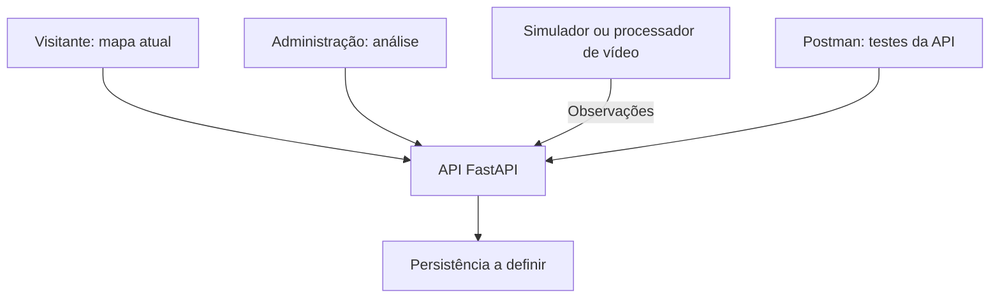

## Proposta e estrutura inicial de testes

> **Conflui: uma visão dinâmica da ocupação e da movimentação de pessoas no shopping.**

Nossa proposta é desenvolver um sistema web que transforme dados de movimentação em uma visualização clara dos espaços do Capim Dourado Shopping. Sobre a planta real, um mapa de calor fluido mostrará onde as pessoas estão concentradas, enquanto os indicadores apresentarão a quantidade estimada em cada setor.

O mapa acompanhará as mudanças na distribuição das pessoas: conforme uma região receber mais público, a concentração aumentará; quando esse público se dispersar, as manchas mudarão de intensidade e distribuição. A visualização será contínua, sem ficar limitada a blocos ou pontos fixos no centro dos setores.

**Para a administração**, o sistema permitirá analisar o shopping inteiro em um mesmo recorte de tempo, identificar áreas com maior ou menor ocupação e compreender como esses padrões mudam. O histórico contemplará segunda a domingo, das 9h até meia-noite, com reprodução da evolução do movimento, comparação entre períodos e análise das passagens entre regiões monitoradas.

**Para os visitantes**, a experiência será simples: consultar o mapa ao vivo, a estimativa de pessoas por setor e a última atualização. Histórico e ferramentas de análise ficarão exclusivos da administração.

**O diferencial da proposta é reunir concentração, quantidade e evolução temporal na mesma planta.** Ao selecionar um horário, o gestor verá todos os setores atualizados em conjunto, podendo comparar a distribuição do público e investigar os fluxos entre regiões. Essa leitura poderá apoiar decisões sobre a utilização dos espaços e permitir que a administração acompanhe mudanças com base em informações organizadas.

A solução completa prevê dados obtidos por processamento de imagens de câmeras, com calibração entre a imagem e a planta. Para o hackathon, o mapa completo será demonstrado com uma simulação espacial identificada, acompanhada, conforme a viabilidade, de uma prova de detecção em vídeo em uma área delimitada. Isso permitirá demonstrar a experiência do produto sem apresentar uma integração completa com as câmeras como se já estivesse validada.

**Estrutura inicial de testes**

Os testes iniciais do Conflui serão organizados para verificar a ocupação apresentada no mapa, a atualização das informações e a separação entre os acessos de visitantes e da administração.

| Teste | Resultado esperado |
| --- | --- |
| Consulta do visitante | Exibir somente o mapa atual, a quantidade estimada por setor e a última atualização. |
| Seleção de dia e horário | Atualizar todos os setores do pavimento no mesmo recorte temporal. |
| Troca de pavimento | Preservar o dia e o horário selecionados pela administração. |
| Reprodução do histórico | Atualizar as manchas e as contagens em conjunto ao longo do período. |
| Movimento no mapa | Alterar a distribuição das manchas conforme as posições recebidas, sem blocos fixos por setor. |
| Ausência de medição | Identificar a região como “sem informação”, diferenciando-a de uma ocupação igual a zero. |
| Acesso administrativo | Restringir histórico, comparações, fluxos e relatórios ao perfil autorizado. |
| Comunicação com a API | Verificar no Postman as respostas, os filtros e o tratamento de erros. |

A prova de conceito com vídeo será avaliada em uma área delimitada, comparando trechos curtos com uma contagem manual. Dados simulados e dados obtidos por vídeo serão identificados separadamente.

## Documentação inicial do projeto

O Conflui será um sistema web para acompanhar a quantidade e a movimentação de pessoas no Capim Dourado Shopping, em Palmas–TO. A solução utilizará a planta real do shopping com um mapa de calor dinâmico, permitindo visualizar a distribuição das pessoas pelos espaços monitorados.

O objetivo é apoiar a administração na compreensão das concentrações, das regiões com menor circulação e das mudanças de movimento ao longo do tempo. Para os visitantes, a proposta é oferecer uma consulta simples da ocupação atual.

| Área e tela | Conteúdo previsto |
| --- | --- |
| Visitante — mapa ao vivo | Planta real, calor contínuo, estimativa por setor, troca de pavimento, zoom, transparência e última atualização. Ao selecionar um setor, exibir nome e ocupação estimada. |
| Administração — visão ao vivo | Mapa, estimativas por setor, total do pavimento monitorado e estado de atualização das informações. |
| Administração — histórico | Consulta de segunda a domingo, das 9h até meia-noite, com filtros de data e horário e reprodução da evolução do movimento. |
| Administração — comparação | Dois períodos lado a lado, com a mesma escala de cores e contagens por setor. |
| Administração — fluxos | Origem, destino, direção e quantidade de passagens entre regiões monitoradas. |
| Administração — relatórios | Resumo das contagens, filtros aplicados, origem dos dados e exportação CSV. |

O visitante terá acesso apenas à situação atual. O histórico, as comparações e a análise de fluxos serão exclusivos da administração.

Ao selecionar um horário, como sábado às 16h, a administração visualizará todos os setores no mesmo instante. A troca de pavimento manterá essa seleção. O histórico utilizará recortes de 15 minutos e resumos horários; a janela das 9h até meia-noite será configurável conforme a operação real do shopping. A consulta por data representará aquele registro específico; uma agregação por dia da semana deverá informar o período utilizado.

As manchas de calor serão formadas a partir de posições distribuídas sobre a planta, mudando de localização e intensidade conforme os dados recebidos. A animação fará transições suaves entre atualizações. As contagens serão calculadas a partir dos registros, e não das cores exibidas no mapa.

Para demonstrar o shopping inteiro no hackathon, será utilizada uma simulação espacial identificada. Uma prova de conceito com vídeo poderá validar a detecção em uma área. A integração real exigirá calibrar a correspondência entre cada câmera e a planta e tratar eventuais sobreposições.

Os dados principais serão setores, pavimentos, posições, horários, contagens estimadas, origem da informação e passagens entre regiões. Ocupação representa pessoas presentes em um recorte; fluxo representa passagens e não equivale a visitantes únicos. Sequências entre regiões dependerão de uma medição capaz de relacionar as observações.

| Endpoint proposto | Finalidade |
| --- | --- |
| `GET /sectors` | Consultar setores, pavimentos e cobertura. |
| `GET /occupancy/live` | Obter a ocupação atual e os dados espaciais agregados para o mapa. |
| `GET /occupancy/history` | Consultar todos os setores no dia, horário e intervalo selecionados. |
| `GET /flows` | Consultar passagens agregadas entre setores. |
| `GET /reports/occupancy` | Obter resumos em JSON ou CSV. |
| `POST /observations` | Receber observações do simulador ou do processador de vídeo por integração autenticada. |
| `POST /auth/login` | Iniciar a sessão administrativa. |

Esta é a documentação de planejamento inicial. Os contratos e as funcionalidades serão implementados e validados durante o desenvolvimento do MVP.

## Linguagem de programação escolhida

| Parte | Linguagem | Aplicação |
| --- | --- | --- |
| Frontend | JavaScript e Tailwind CSS | Estilização visual,Interações, filtros, consultas à API e atualização do mapa. |
| Backend | Python | API, regras de acesso, tratamento dos registros e processamento de vídeo. |

HTML será utilizado na estrutura das páginas, e Tailwind CSS na apresentação visual e na responsividade.

## Arquitetura

A arquitetura será cliente-servidor, com separação entre interface, API, aquisição de dados e persistência. Um único backend atenderá às consultas do sistema. O processamento de vídeo será executado separadamente das requisições HTTP para não bloquear a navegação.

| Componente | Responsabilidade |
| --- | --- |
| Interface web | Consultar a API e apresentar planta, calor, contagens e filtros. |
| API FastAPI | Validar dados, aplicar permissões e disponibilizar ocupação, histórico e fluxos. |
| Aquisição de dados | Enviar observações identificadas como simuladas ou obtidas por vídeo. |
| Persistência | Preservar registros para as consultas históricas; tecnologia a definir pela equipe. |
| Postman | Testar os endpoints e organizar exemplos de requisições e respostas. |

A atualização inicial será feita por consultas periódicas à API, com meta de três segundos entre consultas, sujeita à validação no equipamento da equipe. A animação no navegador poderá ser mais frequente que a aquisição de dados. A execução local será a referência inicial para o MVP.

## Plataforma e tecnologia adotadas

| Tecnologia | Uso previsto |
| --- | --- |
| Aplicação web responsiva | Acesso por navegador em celular e computador. |
| HTML e JavaScript | Estrutura e comportamento da interface. |
| Tailwind CSS | Estilização obrigatória, organização dos componentes e adaptação entre tamanhos de tela. |
| Vite | Ambiente de desenvolvimento e geração do build do frontend. |
| Canvas 2D | Desenho e atualização do mapa de calor contínuo. |
| SVG | Marcadores, delimitações e representação de fluxos. |
| Python e FastAPI | Desenvolvimento da API e das regras do sistema. |
| OpenCV e detector pré-treinado a validar | Leitura e análise do vídeo da prova de conceito. |
| Postman | Testes e documentação dos endpoints da API. |
| Git | Versionamento e colaboração da equipe. |

A coleção do Postman reunirá requisições de setores, ocupação, histórico, fluxos, relatórios e autenticação. Serão verificados campos obrigatórios, filtros, respostas sem dados e restrições de acesso.

O Postman não será utilizado como banco de dados. A tecnologia de persistência permanece a definir e será necessária para preservar o histórico entre execuções.

## Descrição de como a tecnologia ou prática sorteada será incorporada na solução

A tecnologia obrigatória escolhida é o **Tailwind CSS**, dentro da opção CSS3/Tailwind.

O Tailwind será aplicado diretamente ao frontend para construir layouts, menus, filtros, tabelas, painéis, botões e estados de interação. Suas classes utilitárias serão utilizadas para definir cores, tipografia, espaçamentos e comportamento responsivo, mantendo uma apresentação consistente nas áreas pública e administrativa.

O Canvas será responsável pelo desenho do calor, enquanto o JavaScript controlará os dados e a animação. O Tailwind organizará e estilizará a interface que contém essa visualização. CSS complementar poderá atender detalhes específicos do mapa.

A incorporação será demonstrada pela configuração e dependência do Tailwind no projeto, pelo uso das classes no código dos componentes e pelas telas implementadas.
