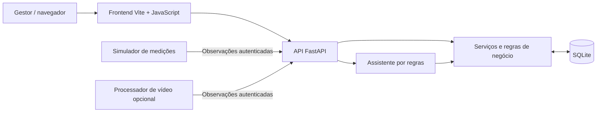

# Conflui — Documentação técnica

> **Inteligência para espaços que estão sempre em movimento.**  
> Plataforma web para observação da ocupação, análise histórica e apoio à gestão operacional de shopping centers.

**MVP:** https://conflui-feraligatr-production.up.railway.app  
**Código-fonte:** https://github.com/Claracastr/Conflui-feraligatr  
**Guia de instalação:** [README_INSTRUCOES_EXECUCAO.md](README_INSTRUCOES_EXECUCAO.md)

---

## 1. Visão geral e problema atendido

A operação de um shopping envolve decisões sobre ocupação, distribuição de pessoas, eventos e utilização dos espaços. Quando essas informações ficam dispersas, torna-se mais difícil identificar concentrações, analisar horários de pico e planejar ações operacionais.

O **Conflui** organiza informações de ocupação por **pavimento, setor, data e horário**. A planta do empreendimento é o centro da navegação: o usuário visualiza um mapa de calor, consulta indicadores, explora históricos e utiliza recursos administrativos e um assistente de análise para interpretar os dados disponíveis.

**Público-alvo:** administração de shopping centers, operações, planejamento e equipes responsáveis por eventos e ocupação dos espaços.

## 2. Funcionalidades do MVP

| Módulo | O que permite fazer |
| --- | --- |
| **Visão geral e mapa de calor** | Visualizar a ocupação nos dois pavimentos e nos 18 setores conceituais cadastrados, com indicação do estado das medições. |
| **Calendário e histórico** | Consultar datas e selecionar horários entre **09h e 00h do dia seguinte**, comparando a ocupação em diferentes momentos. |
| **Gestão de eventos** | Cadastrar, editar, consultar e excluir eventos, relacionando-os a setores e períodos, conforme permissões administrativas. |
| **Perfil do público** | Consultar informações provenientes de **pesquisas agregadas**, separadas da medição por câmeras. |
| **Relatórios** | Consultar indicadores e registros históricos e exportar dados em CSV. |
| **Assistente inteligente** | Fazer consultas em linguagem natural e obter interpretações e sugestões baseadas nos dados disponíveis. |
| **Autenticação e demonstração** | Acesso administrativo por sessão e opção de exploração demonstrativa com permissões limitadas a leitura. |

O assistente é um **protótipo funcional orientado por regras e consultas**. Não deve ser confundido com uma integração já concluída a um modelo generativo externo. A disponibilidade de cada recurso depende do perfil de acesso e do ambiente configurado.

## 3. Arquitetura da solução

O sistema segue uma arquitetura web cliente-servidor, com aquisição de observações separada das requisições do usuário.



### Componentes

| Componente | Responsabilidade | Localização |
| --- | --- | --- |
| Frontend | Navegação, filtros, mapa, Canvas/SVG e consultas à API | `frontend/` |
| API | Autenticação, endpoints, validações e controle de acesso | `backend/conflui/main.py` e `auth.py` |
| Domínio e serviços | Cálculos e consultas de ocupação, histórico e análises | `backend/conflui/services.py` |
| Persistência | Modelos SQLAlchemy e banco SQLite | `backend/conflui/models.py` e `db.py` |
| Migrações | Controle versionado da estrutura do banco | `backend/migrations/` |
| Aquisição | Dados sintéticos ou processamento de vídeo opcional | `backend/conflui/simulator.py` e `video.py` |
| Contratos e testes | Exemplos de API, validações e fluxos de teste | `docs/`, `postman/`, `backend/tests/`, `frontend/tests/` |

## 4. Tecnologias utilizadas

- **Frontend:** JavaScript, HTML, CSS, Tailwind CSS e Vite; Canvas 2D e SVG para visualização interativa.
- **Backend:** Python, FastAPI, Pydantic e SQLAlchemy.
- **Banco de dados:** SQLite, com migrações gerenciadas pelo Alembic.
- **Segurança:** senhas administrativas com hash Argon2id; sessões autenticadas e chave separada para ingestão.
- **Visão computacional (prova de conceito opcional):** OpenCV, YOLO11n e ByteTrack, conforme dependências de vídeo.
- **Qualidade e integração:** Pytest, testes JavaScript, Postman, Git e GitHub.
- **Publicação:** Docker e Railway.

## 5. Como os dados chegam ao mapa de calor

1. Uma fonte de observação — **simulador** ou **processador de vídeo** — produz uma medição associada a câmera, setor e instante de captura.
2. A fonte envia a medição à API, por `POST /observations`, utilizando a chave de ingestão (`X-Ingest-Key`).
3. O backend valida o contrato, a origem, o horário, a câmera e a identificação única da observação; reenvios idênticos não duplicam registros.
4. A medição é persistida no banco e disponibilizada para consultas de ocupação atual ou histórica.
5. A interface representa as contagens e, **quando há posições calibradas**, desenha a distribuição espacial sobre a planta do shopping.

**Importante:** contagem de pessoas e mapa de calor espacial não são a mesma coisa. Sem coordenadas calibradas, o sistema pode apresentar a contagem, mas não deve inventar posições sobre a planta.

### Modos de operação

| Modo | Finalidade | Observação |
| --- | --- | --- |
| `DATA_MODE=simulator` | Demonstração reproduzível, sem exigir câmeras físicas. | Os dados são sintéticos e não representam fluxo real do shopping. |
| `DATA_MODE=video` | Experimento com aquisição por vídeo e medições reais. | Requer câmera cadastrada, configuração específica e validação/calibração em campo. |

Os modos devem utilizar **bases de dados separadas** para impedir mistura entre observações reais e simuladas. O ambiente público do MVP é demonstrativo; a integração física com câmeras deve ser apresentada conforme o estágio real da prova de conceito.

## 6. API e principais contratos

Com o backend em execução:

- **Documentação interativa:** `http://127.0.0.1:8000/docs`
- **OpenAPI:** `http://127.0.0.1:8000/openapi.json`
- **Saúde:** `GET /health`
- **Aquisição:** `POST /observations` com `X-Ingest-Key`
- **Ocupação atual:** `GET /occupancy/live`
- **Histórico:** `GET /occupancy/history?date=AAAA-MM-DD&minute=1080`
- **Análise do assistente:** `POST /assistant/analyze`

A consulta histórica utiliza o fuso **`America/Araguaina`**. O intervalo operacional é representado por `minute=540` (09h) até `minute=1440` (00h do dia seguinte).

Exemplo **ilustrativo de estrutura** de observação:

```json
{
  "observation_id": "camera-cinema-2026-11-14T18:00:00Z",
  "camera_id": "sim-cinema",
  "sector_id": "cinema",
  "captured_at": "2026-11-14T18:00:00Z",
  "count": 12,
  "positions": [{"x": 700, "y": 500}],
  "coordinate_system": "map_1000x734",
  "source": "simulator",
  "status": "available"
}
```

**As informações acima exemplificam o contrato, não medições reais.** Para campos, respostas, restrições, autenticação e demais rotas, consultar [`docs/CONTRATOS.md`](https://github.com/Claracastr/Conflui-feraligatr/blob/main/docs/CONTRATOS.md) e a documentação OpenAPI da versão executada.

## 7. Segurança, acesso e LGPD

O sistema distingue **sessões administrativas**, usadas para ações de gestão, de **acesso demonstrativo**, destinado à exploração dos recursos permitidos sem credenciais de administrador. Ações de escrita devem ser validadas no backend, independentemente de botões estarem ocultos no frontend.

A abordagem de privacidade proposta prioriza **dados agregados por setor e horário**, sem exigir reconhecimento facial ou identificação individual. Isso não elimina automaticamente a incidência da LGPD: o tratamento temporário de imagens de pessoas identificáveis exige avaliação de finalidade, base legal, transparência, retenção, segurança e responsabilidades entre shopping e fornecedor.

Para uma implantação comercial, ainda são necessários controles e validações específicos; **não se afirma que o protótipo possua certificação ou conformidade jurídica integral com a LGPD**.

## 8. Testes, validação e limitações

O repositório contém testes de backend e de contratos JavaScript, além do build do frontend. Os procedimentos para reproduzi-los estão no [README de execução](README_INSTRUCOES_EXECUCAO.md).

**O que o MVP demonstra:** interface funcional, API, persistência, mapa sobre a planta, análises temporais, módulos administrativos e assistente de consultas.

**O que depende de validação posterior:** precisão da contagem por câmera real em condições diversas, cobertura efetiva dos setores, calibração das posições, robustez com múltiplas fontes, governança dos dados e adoção em ambiente comercial.

Os **18 setores** são regiões conceituais da planta; não comprovam cobertura física instalada. Pesquisas de perfil do público também não equivalem a inferências demográficas feitas por câmeras.

## 9. Organização do repositório

```text
Conflui-feraligatr/
├── backend/
│   ├── conflui/              # API, serviços, autenticação, simulador e vídeo
│   ├── migrations/           # Migrações Alembic
│   ├── requirements.txt
│   └── requirements-video.txt
├── frontend/                 # Interface, estilos, scripts, testes e build
├── docs/                     # Contratos, execução e validação
├── postman/                  # Coleção e ambiente de requisições
├── configurar.py             # Configuração inicial e dados de demonstração
├── iniciar.py                # Inicia API e simulador local
├── Dockerfile
└── README.md
```

## 10. Aplicação e evolução

O Conflui pode apoiar a identificação de áreas com concentração de público, a análise de padrões por horário, a preparação de eventos e o planejamento de ações operacionais. Para evoluir do MVP a um piloto em shopping real, o próximo passo é mapear as câmeras disponíveis, calibrar os setores, medir erros de contagem, definir governança de dados e validar a experiência com gestores.

---

**Conflui — HackaRun**  
Documentação de referência do MVP. Funcionalidades e contratos devem ser conferidos contra a versão efetivamente publicada no repositório.
